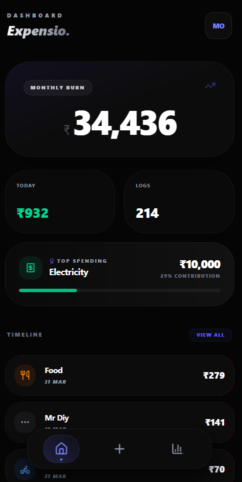

# 💸 Expensio



---

## 🚀 Overview

Expensio is a modern, intuitive expense tracking web application designed to help users manage their finances effortlessly. It allows users to record, categorize, and analyze their expenses in real-time with a clean and interactive UI.

Built with performance and user experience in mind, Expensio leverages modern frontend technologies and a scalable backend to deliver a seamless financial tracking experience.

---

## ✨ Features

- 📊 Track daily expenses with ease  
- 🧾 Categorize transactions for better insights  
- 📈 Interactive UI with smooth animations  
- 🔐 Secure data handling using Supabase  
- ⚡ Fast and responsive performance  
- 📱 Fully responsive design for all devices  

---

## 🛠 Tech Stack

- **Frontend:** React  
- **Styling:** Tailwind CSS  
- **Animations:** Framer Motion  
- **Backend & Database:** Supabase  
- **Deployment:** Vercel  

---

## 📁 Project Structure

```
Expensio/
│
├── public/
│   └── preview.png
│
├── src/
│   ├── components/
│   ├── pages/
│   ├── hooks/
│   ├── utils/
│   ├── assets/
│   └── App.jsx
│
├── package.json
├── tailwind.config.js
├── vite.config.js
└── README.md
```

---

## ⚙️ Getting Started

Follow these steps to run the project locally:

### 1. Clone the repository

```
git clone https://github.com/your-repo/expensio.git
```

### 2. Navigate to the project directory

```
cd expensio
```

### 3. Install dependencies

```
npm install
```

### 4. Start the development server

```
npm run dev
```

---

## 🌐 Live Demo

👉 https://expensio.dev

---

## 🔮 Future Improvements

- 📊 Advanced analytics with charts and reports  
- 🧠 AI-based expense insights and suggestions  
- 🔔 Smart notifications for spending limits  
- 🧾 Export reports as PDF/CSV  
- 👥 Multi-user support with shared budgets  

---
